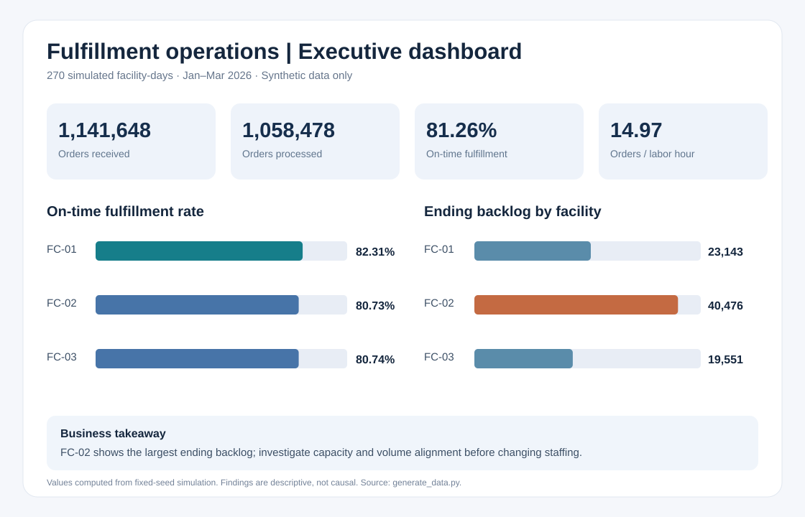

# Fulfillment Operations & Workforce Analytics

**SQL · Python · Operational KPIs · Business insights · Reproducible analytics**

A complete, independent portfolio case study demonstrating how an analyst can connect workforce capacity, order flow, service levels, and quality to practical operational decisions.

> **Data integrity:** Every observation is **synthetic** and generated for this portfolio. No Amazon, Apple, customer, or employer-proprietary data is used. The business findings describe a simulation, not actual company performance.



## Executive summary

Across **270 simulated facility-days** (three facilities, 90 days), the model generated **1,141,648 orders received** and **1,058,478 processed**, with **81.26%** on-time fulfillment and **14.97** processed orders per actual labor hour.

**Three decision-oriented findings:**

1. **Prioritize FC-02 capacity analysis:** FC-02 had the largest ending backlog (**40,476 orders**) and the lowest on-time rate (**80.73%**). Evaluate volume and capacity alignment before recommending staffing changes.
2. **Investigate staffing-coverage gaps:** Facility-days below 90% staffing coverage had **80.66%** weighted on-time fulfillment versus **81.69%** on higher-coverage days. This is descriptive, **not causal**.
3. **Balance throughput with service:** Facility productivity was tightly clustered (**14.90–15.02 orders/labor hour**), but service outcomes differed. A scorecard should include on-time fulfillment, backlog, quality, and labor productivity.

**[Read the full executive analysis and recommendations →](BUSINESS_INSIGHTS.md)**

## Project navigation

| Resource | Purpose |
|---|---|
| [Executive insights](BUSINESS_INSIGHTS.md) | Three quantified findings, recommendations, limitations |
| [Dashboard](dashboards/operations_dashboard.svg) | Visual KPI overview and facility comparison |
| [Jupyter notebook](notebooks/operations_analysis.ipynb) | Exploratory KPI calculations and charts |
| [Data generator](generate_data.py) | Reproducible 270-row synthetic dataset |
| [SQL KPI queries](sql/02_kpi_analysis.sql) | Weighted facility-level performance metrics |
| [SQL diagnostic query](sql/03_root_cause_analysis.sql) | Staffing segmentation and exploratory comparison |
| [SQL validation](sql/01_data_validation.sql) | Quality and logical checks |
| [Automated workflow](.github/workflows/analytics.yml) | Tests, SQL validation, generated CSV and PNG artifacts |

## Reproduce the analysis

Requires Python 3.11 or later.

```bash
python -m pip install -r requirements.txt
python generate_data.py
python -m unittest discover -s tests -v
python validate_sql.py
python analyze.py
```

This generates `data/fulfillment_operations.csv` and `dashboards/on_time_by_facility.png`. Open the notebook from the repository root in Jupyter to explore the dataset.

**Without local setup:** Open [GitHub Actions](../../actions), select the latest successful **Validate and build analytics artifacts** run, and download the `fulfillment-analytics-results` artifact containing the generated CSV and PNG.

## Data dictionary and KPIs

| Field / KPI | Definition |
|---|---|
| `date`, `facility` | Facility-day identifiers |
| `scheduled_staff`, `actual_staff` | Planned and observed simulated staffing |
| `scheduled_labor_hours`, `actual_labor_hours` | Eight hours per staff member |
| `forecast_orders`, `orders_received` | Simulated demand forecast and intake |
| `orders_processed`, `on_time_orders` | Daily throughput and service performance |
| `defect_count`, `backlog_orders` | Simulated quality issues and ending queue |
| Orders per labor hour | Sum(processed orders) / sum(actual labor hours) |
| On-time rate | Sum(on-time orders) / sum(processed orders) |
| Staffing coverage | Sum(actual staff) / sum(scheduled staff) |
| DPMO proxy | 1,000,000 × sum(defects) / sum(processed orders), one opportunity per order |
| Forecast error | (Actual intake − forecast intake) / forecast intake |

Backlog carries forward within each facility: **ending backlog = previous ending backlog + orders received − orders processed**. The generator limits processed orders to available work and simulated capacity.

## Methodology and limitations

- Fixed random seed (`42`) ensures reproducibility.
- Metrics are **weighted** using total numerators and denominators, not averaged daily percentages.
- The simulator intentionally relates backlog to late-order share; associations are therefore model-dependent and **do not establish real-world causality**.
- Simulated staffing, capacity, defect rates, and service levels are illustrative, not operational benchmarks.
- Recommendations are hypotheses to test, **not claims of realized improvements or cost savings**.

## Tools demonstrated

**Python:** synthetic data generation, CSV processing, matplotlib, unit tests. **SQL (SQLite):** data quality checks, weighted KPI reporting, segmentation. **GitHub Actions:** reproducible build, automated validation, downloadable analysis artifacts. **Communication:** executive dashboard, quantified findings, and business recommendations.
